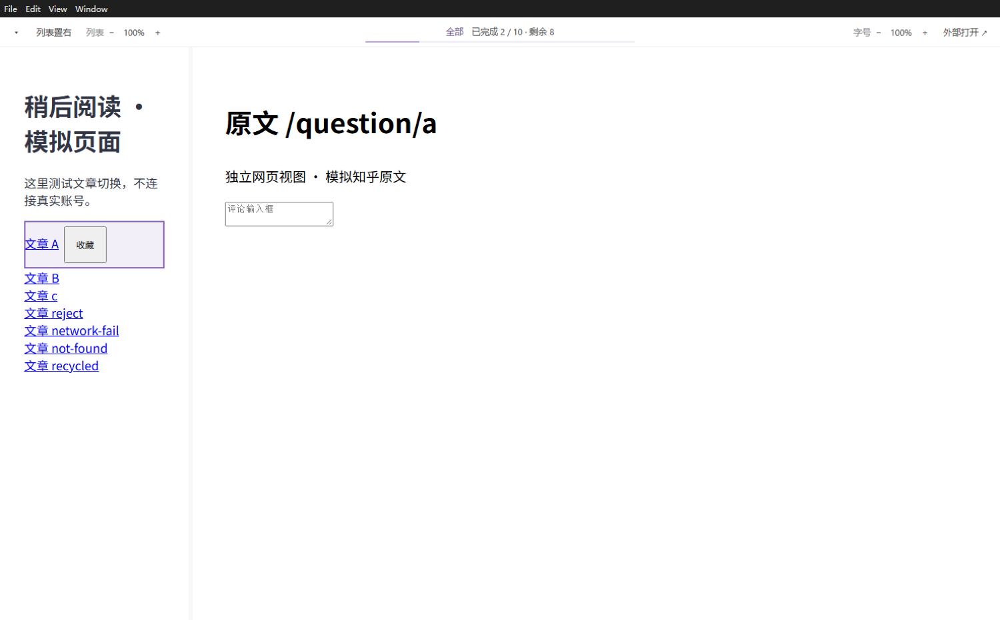
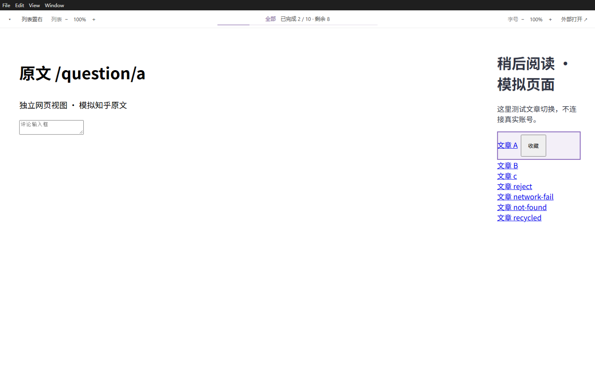

# QiReader Desktop 0.6.1（非官方）

QiReader 列表可放在左侧或右侧，原文显示在另一侧；隐藏列表时全宽阅读。独立网页视图不是 iframe，无需批量打开浏览器标签页。

这是非官方 Electron 桌面壳，在线加载 QiReader 与文章原网页，不包含 QiReader 网页或服务端源码，与 QiReader 官方没有隶属关系。使用时需要网络及自己的 QiReader 账号。

## 界面截图

以下为 Windows 隔离演示页面，展示桌面外壳的工具栏、阅读进度及左右布局。页面内容为测试数据，不是实际 QiReader 界面或用户文章，不包含真实账号、订阅或文章正文。

列表放在左侧：



列表放在右侧：



## Windows 使用

从 [GitHub Releases](https://github.com/xxs9331/qireader-desktop/releases) 下载 `QiReader-Desktop-0.6.1-win32-x64.zip`，完整解压后打开其中的 `QiReader-Desktop.exe`。请保留同目录的所有文件，不能只复制 exe。可自行为 exe 创建桌面快捷方式。

当前提供 Windows x64 便携版，尚未签名，系统可能提示未知发布者。下载可用 Release 中的 `SHA256SUMS.txt` 校验。更新时关闭旧版程序，再解压到新目录；不要删除下方说明的应用数据目录，登录和统计记录会继续保留。

## 顶部阅读进度

顶部居中显示「今日 · 已完成 / 总数 · 剩余」和细进度线，点击周期按「今日 → 本周 → 全部」循环切换，本周从本地时间周一开始。三个范围都显示进度条，点击计数手动同步。只统计稍后阅读，按 QiReader 的收录时间 `crawledAt` 划分今日／本周，不是文章发布时间，也不推测加入标签的时间。「全部」包括所有已记录的待看和已完成文章。鼠标悬停可查看统计口径、记录开始时间及最近同步时间。「往期」显示当前周期以前仍在稍后阅读的文章数，点击打开完整稍后阅读列表；全部范围不重复显示往期。

QiReader 加入稍后阅读时可能已将文章标为已读，因此这里以「移出稍后阅读」计为完成，包括手动移出。自动移出须获服务器确认才增加完成数；回看不重复计数，重新加入后恢复待看。跨天和跨周会重新计算周期，已完成文章持续保留在全部总数中。

统计约每 5 分钟完整同步一次，回到窗口时会按需同步；其他设备的移出会在同步后体现。本机只保存文章 ID、收录时间和完成状态，按站点与账号分别存储于应用数据目录的 `reading-progress.json`，关闭重开仍保留。首次启用前或程序未记录期间已经加入又移出的文章无法补回，数字表示已记录范围，不代表完整历史流水。没有记录、没有文章、同步失败会分别显示，不会把接口失败当成全部读完。

完整分页成功后才更新总数；网络或格式错误保留上次结果并标记待同步。文章打开时先记录其统计信息，若统计信息无法确认则仍展示原文、暂时保留稍后阅读条目并提示重试，避免先移出后丢失总数。统计接口均只读，移出仍使用原生控件。

## 阅读操作

1. 顶部不再显示「稍后阅读」按钮；在 QiReader 原生列表中选择文章即可。点击文章或在条目上按 Enter/o，保持当前的列表显示状态，不自动收起，也不在失败后自动展开。
2. 在稍后阅读列表中，原文加载成功后自动触发 QiReader 原生移除动作；其他列表不自动移除。原文加载失败或 HTTP 4xx/5xx 时不移除。移除由服务器确认，不直接调用私有写接口。
3. 「列表置右／列表置左」切换列表位置，保留宽度和当前的展开状态。默认 280px，拖动两栏之间的细分隔线调整，可窄至 180px；右侧列表向左拖会加宽。分隔线也支持键盘左右箭头。拖动期间显示当前页面临时预览，松开恢复网页交互，预览不存盘。
4. 左上角 ▾/▸ 手动控制列表，隐藏时原文全宽显示。仅列表关闭且已打开文章时，左下角显示悬浮 ←/→ 切换上一篇/下一篇；展开列表后隐藏悬浮控件，使用列表内的原生翻篇按钮。悬浮控件只占自身的小区域，不预留整条底栏；已移出的文章可以回看，不会再次切换稍后阅读状态。
5. 阅读顺序取自选择文章时的列表，并随着新条目渲染补充。点击其他文章会开始该列表的新一轮顺序；手动刷新列表会重置本轮历史。本版不额外请求 QiReader 私有分页接口，列表尚未加载的更远条目需先加载。
6. 两边分别用「字号 − / 百分比 / ＋」调整网页缩放，范围 50%–200%。百分比按钮恢复 100%；页面获得焦点后也可 Ctrl +/−/0 或 Ctrl + 滚轮。缩放包含文字和网页布局，不改网站字体设置；当前窗口内跨文章保留，尚未跨程序重启保存。
7. 错误提示暂时替换顶部统计，点击关闭后恢复进度条。移除失败且条目恢复后可重新点选该文章重试；移除未确认时应先通过原生列表或重新打开程序核对，不凭列表的临时消失判断服务端成功。

## 当前范围

- 从列表标题读取原文地址，不触发 QiReader 原生文章页。原生收藏、复选框和操作按钮保留原行为。没有有效原文链接时保留 QiReader 原生打开方式。
- 自动移除仅作用于 `/tags/!readlater` 当前列表；加载期间切换列表或原条目已被虚拟滚动替换时，不操作其他条目。用户原有 Chrome 扩展队列不参与此流程。
- 原文复用同一个视图。回到列表点击同一篇可重新加载。列表位置、宽度与缩放在当前窗口内保留，尚未跨程序重启保存。
- 登录 Cookie 和站点存储持久化；原站点的会话过期规则仍然适用。
- 外部网站不开放 Node.js 或本地系统 API；保留浏览器沙箱、同源限制和 TLS 校验。
- 本版没有移植 Quick Tags，也不读取、迁移、清空 Chrome 扩展队列。
- 相机、麦克风、通知等额外权限默认拒绝。

尚未增加分类快捷键、置顶小窗、自动更新或正文提取器。直接访问 QiReader 文章路由或无原文链接时仍保留原生正文作为兜底，该兜底不自动移除稍后阅读。

Cubox 尚未接入，保留「外部打开」按钮。正式程序不加载 Cubox 插件、不导入 Chrome 数据、不调用 Cubox API。

## 开发与验证

需要 Node.js 22.12+。

```sh
npm ci
npm start
npm test
npm run test:browser
npm run package:win
```

Windows 隔离回归可用 PowerShell 执行 `test/windows-smoke.ps1 -RuntimeZip <electron-v45.0.0-win32-x64.zip 的完整路径>`；使用 Electron 官方 Windows 运行时 ZIP，测试会创建并清理独立临时配置。

浏览器测试运行真实 Electron，使用隔离临时配置及模拟 QiReader/原文响应，不接触个人账号。覆盖文章联动、SPA 延迟渲染、IPC 来源验证、危险 URL 拒绝、双栏布局、登录弹窗、加载失败恢复、进程重启后的存储保留和窗口释放。测试截图在 `artifacts/smoke-平台名.png`。

模拟页面测试不能证明线上 QiReader DOM 和知乎登录兼容性。发布前应在 Windows 实测：选择多篇文章、切换列表、知乎登录及评论、关闭重开程序。不要将模拟测试描述为真实账号验收。

应用依赖 QiReader 当前 DOM 中的 `data-is-entry` / `data-is-entry-title` 列表标记；直接进入文章路由时用 `articleView`、`data-article-url` 兜底。页面改版时调整 `reader-preload.cjs`。未改写网页网络请求。

Windows 包暂未签名。正式包应用数据位于 `%APPDATA%/QiReader Desktop`，请不要删除此目录来更新软件。

## 第三方与授权边界

- QiReader 名称及其网站、界面和内容的权利归相应权利人所有。本项目的“非官方”说明不代表获得了 QiReader 的授权或认可。
- [QiReader 官方仓库](https://github.com/oxyry/qireader/blob/main/package.json) 标注 `UNLICENSED`，不可据此将 QiReader 当作开源软件复制或再发行。本项目仅包含独立桌面外壳及其交互代码。
- 阅读统计使用已登录会话访问 QiReader 的非公开文档接口。尚未取得官方对第三方客户端及这些接口调用的书面许可；接口可访问不等于获得使用授权，兼容性和使用权限均可能变化。使用者应遵守 QiReader 及文章来源站点适用的条款。
- Electron 使用 [MIT 许可证](https://github.com/electron/electron/blob/main/LICENSE)。Windows 包保留运行时附带的 `LICENSE` 和 `LICENSES.chromium.html`；这些是第三方组件声明，不是 QiReader 的授权，也不构成本项目对所有法律风险的保证。

本仓库没有为自有代码另行指定开源许可证；公开可见不等于授予任意复制、修改、再发行的许可。上述说明不是法律意见。
